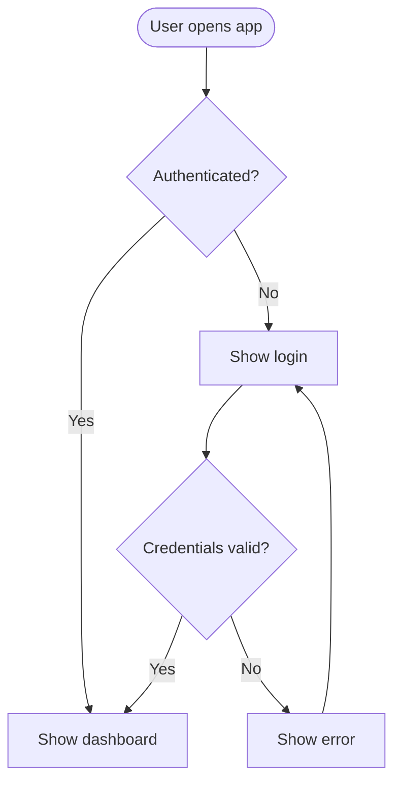
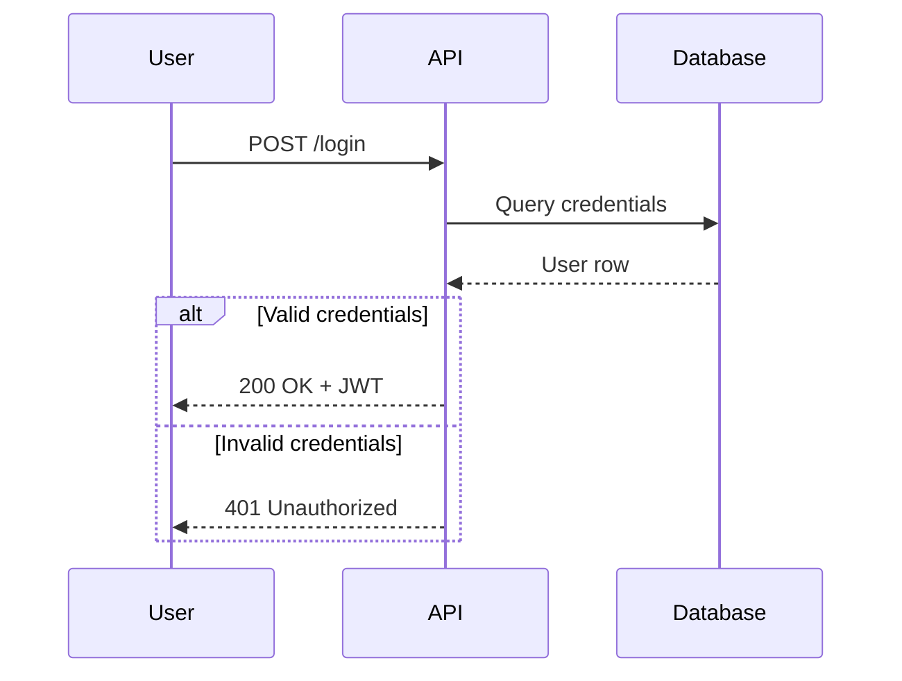
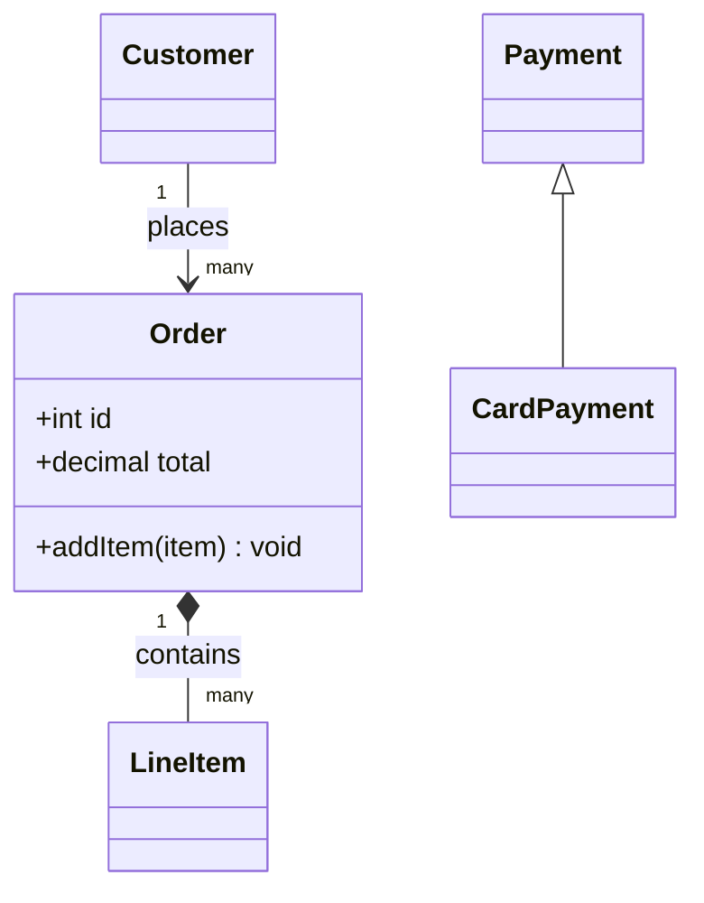
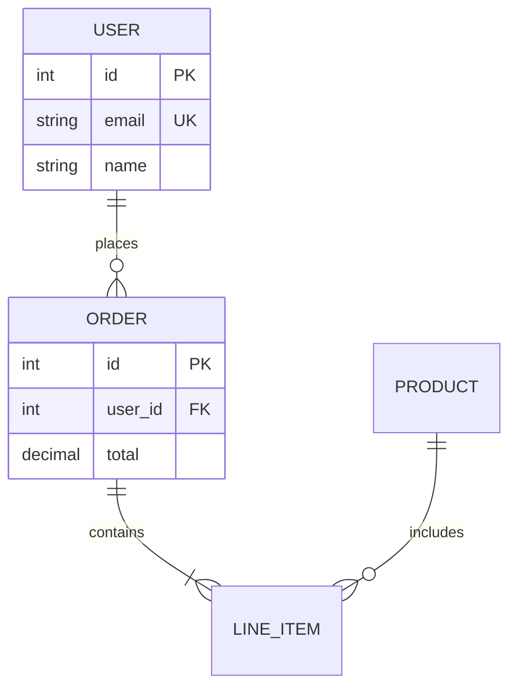
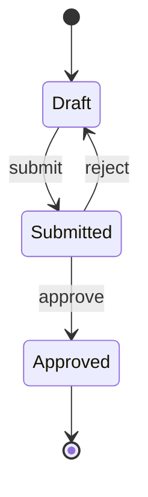
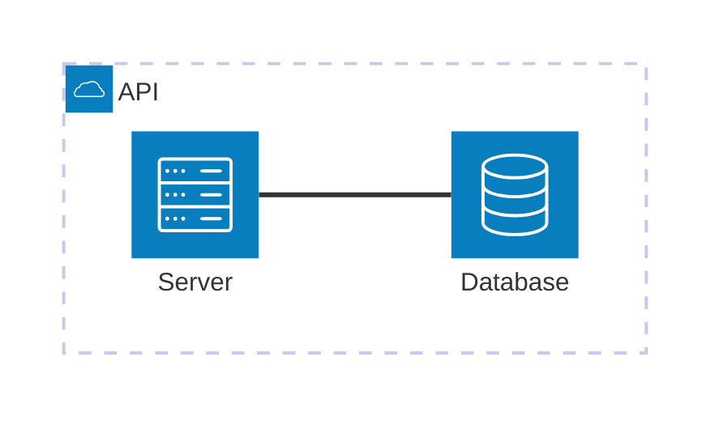

# Mermaid Diagrams

Produce Mermaid diagrams that render on the first try, are correct against the user's description, and stay maintainable as text next to the code.

## Workflow

1. **Understand** - identify the components, the connections (with direction), and the question the diagram must answer. If the request is too vague to draw anything meaningful, ask one short question; otherwise pick sensible defaults and state them.
2. **Pick the diagram type** using the table below. One diagram answers one question; split large systems into several focused diagrams.
3. **Write the code** following the syntax rules and gotchas in this file.
4. **Validate** (see "Validation") whenever a shell is available. Never hand over code you know does not parse.
5. **Review against the requirements** (see "Review checklist") and fix before delivering.
6. **Deliver** according to "Output rules".

## Choosing the diagram type

| Need | Type | Keyword |
|---|---|---|
| Process, algorithm, decision logic, user journey | Flowchart | `flowchart TD` / `LR` |
| Interaction over time, API calls, auth flow | Sequence | `sequenceDiagram` |
| Domain model, OOP structure, inheritance | Class | `classDiagram` |
| Database schema, entity relationships | ER | `erDiagram` |
| Lifecycle, state machine | State | `stateDiagram-v2` |
| System context / containers / components | C4 | `C4Context`, `C4Container`, `C4Component` |
| Cloud / infra / deployment layout | Architecture | `architecture-beta` |
| Project schedule | Gantt | `gantt` |
| Branching strategy | Git graph | `gitGraph` |
| Hierarchy, brainstorm | Mindmap | `mindmap` |
| Milestones | Timeline | `timeline` |
| Proportions / simple series | Pie, XY chart | `pie`, `xychart-beta` |
| 2x2 prioritisation | Quadrant | `quadrantChart` |
| Flow volumes | Sankey | `sankey-beta` |
| Tasks by status | Kanban | `kanban` |
| Multi-dimension comparison | Radar | `radar-beta` |

Newer types (`architecture-beta`, `xychart-beta`, `sankey-beta`, `radar-beta`, `kanban`, C4) are still evolving. If one fails to parse, check the installed Mermaid version before blaming the code, and fall back to a flowchart if needed.

## Core syntax rules

- The first line declares the diagram type. `%%` starts a comment.
- Use semantic node IDs (`authServer`, `userDb`), never `A`, `B`, `C`. Put the human-readable text in the label: `authServer["Auth Server"]`.
- Always quote labels that contain spaces plus punctuation, parentheses, brackets, colons, slashes, or non-ASCII text: `node["Validate (JWT)"]`.
- Line breaks inside labels: use `<br/>`. Never `\n` (renders literally).
- Keep one consistent direction: `TD` for hierarchies and decisions, `LR` for pipelines and data flow.
- Group related nodes with `subgraph name["Title"]` ... `end`.
- Style sparingly: a few `classDef` classes (e.g. `classDef store fill:#e8f1ff,stroke:#2563eb`) beat per-node colors. Do not use rainbow palettes. Keep the diagram readable in grayscale.

### Gotchas that silently break diagrams

- The lowercase word `end` as a node ID or label breaks flowcharts. Use `End`, `END`, or quote it.
- A node ID starting with `o` or `x` right after an edge (`A---oB`, `A---xB`) is parsed as a circle/cross edge end. Add a space (`A --- oB`) or rename the node.
- Do not put `{}` inside `%%` comments.
- Unknown keywords and misspelled parameters can fail silently, so validate instead of assuming.
- Semicolons and `#` in labels can truncate text. Quote the label or use entity codes (`#59;`).
- Very wide diagrams become unreadable. Split them or switch to `TD`.

## Per-type quick reference

### Flowchart

Shapes: `[rect]`, `(rounded)`, `([stadium])`, `{decision}`, `[(database)]`, `[[subroutine]]`, `((circle))`. Edge styles: `-->`, `-.->`, `==>`, labels via `-->|text|`.

### Sequence

`->>` sync request, `-->>` response/async, `-)` fire-and-forget. Blocks: `alt/else`, `opt`, `loop`, `par`, `critical`. Use `activate`/`deactivate` (or `+`/`-` suffix) for lifelines and `Note over A,B:` for context.

### Class

Relationships: `<|--` inheritance, `*--` composition, `o--` aggregation, `-->` association, `..>` dependency, `..|>` realization.

### ER

Cardinality: `||` exactly one, `o|` zero or one, `}o`/`o{` zero or many, `}|`/`|{` one or many. Attribute keys: `PK`, `FK`, `UK`.

### State


### C4
Use `C4Context` for people and external systems, `C4Container` for deployable units, `C4Component` for the internals of one container. Keep each C4 diagram at a single level of abstraction. `Container` and `Component` take technology before description.

**Before writing a C4 diagram, read `references/c4.md`** (element signatures, boundaries, layout config, common mistakes).

### Architecture (`architecture-beta`)
Requires Mermaid >= 11.1.0. Think of the canvas as an invisible grid. Declare `group`, `service`, `junction`, then edges with port sides (`T`, `B`, `L`, `R`):

**Before writing a non-trivial one, read `references/architecture.md`** (icons and `--iconPacks`, edge syntax, junction and `{group}` layout recipes). Edges cannot carry labels, so put protocol info in service titles.

## Math (KaTeX)

Supported in `flowchart` and `sequenceDiagram` (node/edge labels, participant aliases, messages, notes). Rules:
- Wrap math in `$$...$$` and put it **inside a quoted string**: `scores["$$\frac{QK^T}{\sqrt{d_k}}$$"]`.
- Mix text and math by wrapping only the math part: `layer["Linear $$W_1 x + b_1$$"]`.
- Use `\text{...}` for plain words inside math.
- Very long formulas overflow the node; split them or simplify.
- Use math only when the content actually contains formulas or Greek symbols; otherwise plain labels with `<br/>`.

## Theming and configuration

Per-diagram config goes in frontmatter at the very top:
```
---
config:
  theme: base
  themeVariables:
    primaryColor: "#e8f1ff"
    primaryBorderColor: "#2563eb"
    lineColor: "#333333"
  layout: dagre
---
```
Themes: `default`, `forest`, `dark`, `neutral`, `base`. `layout: elk` helps with dense graphs where supported. `look: handDrawn` gives a sketch style. Prefer `neutral` or `base` with a small palette for documentation and anything that may be printed.

For diagrams destined for papers or slides: white background, sans-serif text, 3-5 muted colors, dark arrows with labels on every edge, left-to-right flow, no arrow crossings if avoidable.

## Validation

Run when a shell is available and the diagram is non-trivial or will be saved:

```bash
# source in diagram.mmd (no markdown fences)
npx -y @mermaid-js/mermaid-cli -i diagram.mmd -o diagram.png -b transparent
```

- If `mmdc` is installed globally, use it directly.
- In sandboxes/containers Chromium often refuses to start as root. Create `puppeteer-config.json` containing `{"args": ["--no-sandbox"]}` and add `-p puppeteer-config.json`.
- On a parse error: read the message (it names the line), fix the source, re-run. Stop after 3 attempts; if still failing, simplify the diagram or tell the user exactly what blocks it.
- If rendering is impossible (no Node, no network), say the diagram was not machine-validated and re-read the code once for the gotchas above.
- If the PNG renders, look at it. Layout problems (overlap, tiny text, tangled edges) are fixed by changing direction, splitting subgraphs, or adding junctions, not by adding more styling.

## Review checklist

Before delivering, check against the user's request, not against taste:
- Every component the user mentioned is present, with a clear label.
- Every arrow points the right way (source to target, request vs response, dependency direction). A wrong direction is the most common real error.
- Edge labels say what flows or what the condition is.
- The diagram answers one question and can be read in a few seconds.
- No leftover placeholder IDs, no `\n` in labels, no unquoted special characters.

Fix issues and re-validate. Do not run score-based loops.

## Output rules

- **Quick question or discussion:** put the Mermaid code in a fenced ```mermaid block in the reply, then one or two sentences on what it shows or the assumptions made.
- **User asks for a file, an image, or the diagram belongs to a project/doc:** save `<kebab-case-name>.mmd` containing only the raw Mermaid source (no fences). Add a `.md` file with a title, one-line description and the fenced block only if the diagram is meant to be previewed on GitHub or in docs. Add the rendered `.png`/`.svg` when validation produced one and the user wants an image. Use the user's existing docs/diagrams folder if there is one; otherwise `docs/diagrams/` or the working directory.
- When several files are written, the `.mmd` and `.md` must contain identical Mermaid code.
- After saving, tell the user the file paths and how to re-render: `mmdc -i <name>.mmd -o <name>.png`.
- Mermaid renders natively on GitHub, GitLab, Obsidian, Notion, Confluence, and in VS Code with a Mermaid Markdown extension. Mermaid Live (mermaid.live) is the fastest place to preview and export.

## Style defaults

- Names: descriptive kebab-case for files; camelCase semantic IDs for nodes.
- Comments: use `%%` to explain non-obvious relationships in larger diagrams.
- Update, don't redraw: when the user changes the system, edit the existing source and keep IDs stable so diffs stay small.
- Keep text short: labels are noun phrases or verbs, details go in notes or the surrounding prose.
