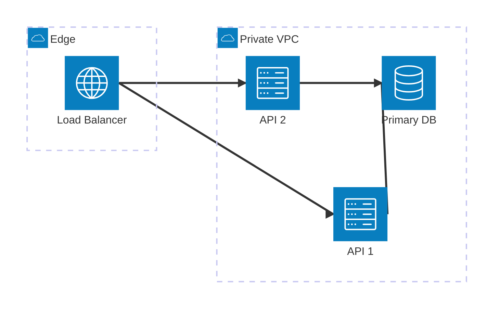

# architecture-beta reference

Read this when drawing cloud/infra/deployment layouts with `architecture-beta`. Requires Mermaid >= 11.1.0. For anything older or when edge labels are needed, use a flowchart with subgraphs or C4.

## Building blocks

```
group   {id}({icon})[{title}] (in {parentGroupId})?
service {id}({icon})[{title}] (in {groupId})?
junction {id} (in {groupId})?
{id}{group}?:{T|B|L|R} {<}?--{>}? {T|B|L|R}:{id}{group}?
```

- `in` must reference a **group**, never another service.
- Edge ports say which side of each node the line leaves/enters: `api:R --> L:db` goes from the right side of `api` to the left side of `db`. Use `--` (no arrow), `-->`, `<--`, `<-->`.
- `{group}` after an id makes the edge attach to the group boundary instead of the node: `client{group}:B --> T:api{group}`.
- Edges carry no labels. Put protocol or technology into the service title (`[API<br/>HTTPS]`) or switch to another diagram type.



## Icons

- Built in: `cloud`, `database`, `disk`, `internet`, `server`. Stick to these unless an icon pack is registered; unknown icon names render blank or fail.
- Extra packs come from Iconify (`pack:icon-name`, e.g. `logos:docker`, `mdi:database`, `aws:ec2` only if such a pack is registered).
- With the CLI, install the pack and pass it explicitly or the icons will not appear:

```bash
npm install @iconify-json/logos @mermaid-js/mermaid-cli
npx mmdc --iconPacks @iconify-json/logos -i diagram.mmd -o diagram.svg
```

Useful packs: `@iconify-json/logos` (tech brands), `@iconify-json/mdi` (Material), `@iconify-json/simple-icons`, `@iconify-json/bi`.

In validation sandboxes without that pack, validate the layout with built-in icons first, then swap icon names.

## Layout control

The canvas is an invisible grid; Mermaid places nodes by the port sides you choose, so wrong ports are the usual cause of ugly layouts. Rules of thumb:

- Horizontal flow: `A:R --> L:B`. Vertical flow: `A:B --> T:B2`.
- Fan-out from one node: route through a `junction` placed beside it.

```
junction jLb
lb:R -- L:jLb
jLb:T -- B:jScim
jLb:B -- T:jWebapi
jScim:R --> L:scim
jWebapi:R --> L:webapi
```

- A service with no real relationship to its neighbors (deploy tool, monitor): anchor it with a junction and `{group}` instead of inventing a false edge.

```
junction jAnchor
neighborInGroup{group}:B -- T:jAnchor
jAnchor:B -- T:floatingService
```

- Keep to roughly 15 services per diagram; split by layer or environment beyond that.
