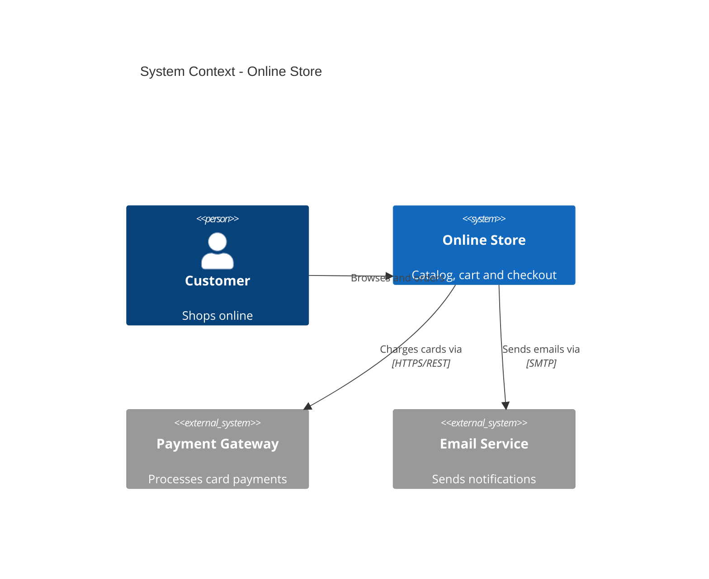
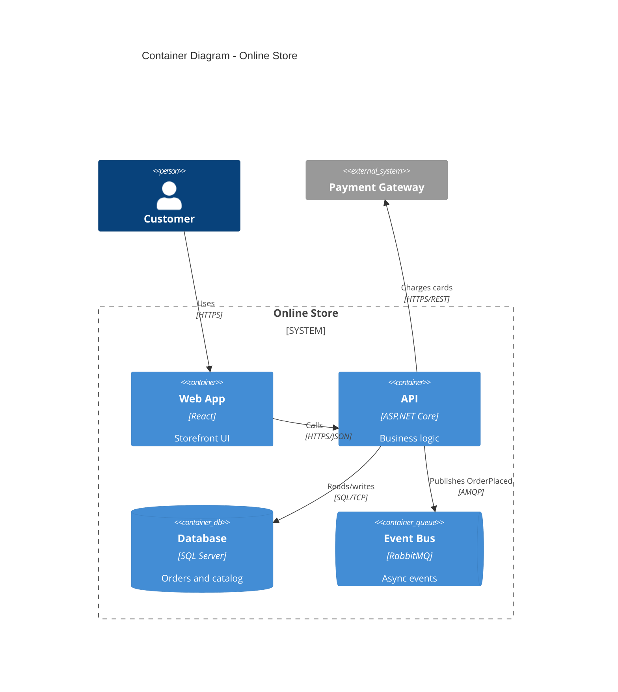
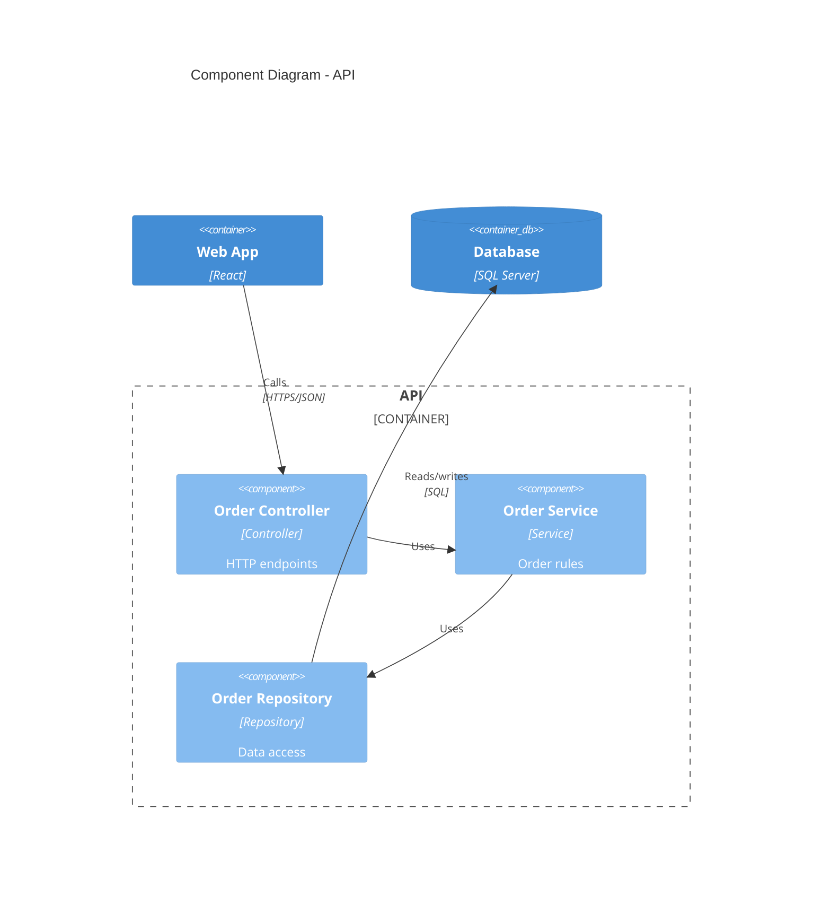

# C4 reference

Read this when drawing C4 diagrams. Mermaid's C4 support is experimental: layout is semi-automatic, edges can overlap labels, and syntax follows the C4-PlantUML macros. Validate with `mmdc` and fall back to a flowchart with subgraphs if the result is unreadable.

## Pick one level per diagram

| Level | Keyword | Shows | Audience |
|---|---|---|---|
| 1. Context | `C4Context` | The system, its users, external systems | Everyone |
| 2. Container | `C4Container` | Deployable/runnable units: apps, services, databases, queues | Architects, devs |
| 3. Component | `C4Component` | Internals of ONE container | Devs |
| 4. Code | use `classDiagram` | Classes inside one component | Devs |
| Deployment | `C4Deployment` | Containers mapped onto infrastructure nodes | Ops |
| Dynamic | `C4Dynamic` | Numbered runtime interactions for one scenario | Anyone |

Start at Context and drill down only as far as the question needs. Use the same names for the same things at every level. Never mix levels in one diagram.

## Element signatures

Arguments are positional and strings are quoted. Container/Component put **technology before description**, which is easy to get backwards:

```
Person(alias, "Label", "Description")
Person_Ext(alias, "Label", "Description")

System(alias, "Label", "Description")
System_Ext / SystemDb / SystemDb_Ext / SystemQueue / SystemQueue_Ext

Container(alias, "Label", "Technology", "Description")
Container_Ext / ContainerDb / ContainerDb_Ext / ContainerQueue / ContainerQueue_Ext

Component(alias, "Label", "Technology", "Description")
Component_Ext / ComponentDb / ComponentQueue

Rel(from, to, "Label", "Technology")      %% technology optional
BiRel(a, b, "Label", "Technology")
Rel_U / Rel_D / Rel_L / Rel_R(from, to, "Label")   %% direction hints
```

- Aliases must be unique across the whole diagram and are what `Rel` refers to.
- Use `_Ext` variants for anything outside the system boundary, `Db` for data stores, `Queue` for brokers.
- Relationship labels are verbs ("Reads from", "Publishes to"); put protocol/tech in the 4th argument ("HTTPS/JSON", "SQL", "AMQP").

## Boundaries

Boundaries use braces and group elements visually:

```
Enterprise_Boundary(alias, "Label") { ... }
System_Boundary(alias, "Label") { ... }
Container_Boundary(alias, "Label") { ... }
Boundary(alias, "Label", "type") { ... }
```

- In `C4Container`, wrap the system's own containers in `System_Boundary`/`Container_Boundary`; leave users and external systems outside.
- In `C4Component`, wrap the components of the single container in `Container_Boundary`.

## Layout and styling

- Elements are laid out in rows in declaration order. Control row width with `UpdateLayoutConfig($c4ShapeInRow="3", $c4BoundaryInRow="1")` (put it last).
- Declare elements in reading order (users first, then your system, then externals/data) so edges stay short.
- Nudge a crowded label with `UpdateRelStyle(from, to, $offsetX="-40", $offsetY="-20")`; recolor with `$textColor`, `$lineColor`.
- `UpdateElementStyle(alias, $bgColor="#e8f1ff", $borderColor="#2563eb", $fontColor="#000")` for a few highlighted elements. Do not restyle everything.
- Keep to about 12-15 elements per diagram. Beyond that, split by boundary or move down a level.

## Examples

Context:



Container:



Component (one container only):



## Common mistakes

- Swapping technology and description in `Container`/`Component`.
- Showing a database inside the Context diagram (it belongs at Container level).
- Putting external systems inside the system boundary.
- Duplicate aliases, or a `Rel` pointing at an alias that was never declared.
- Arrows labelled with nouns ("data") instead of what happens ("Sends order events to").
